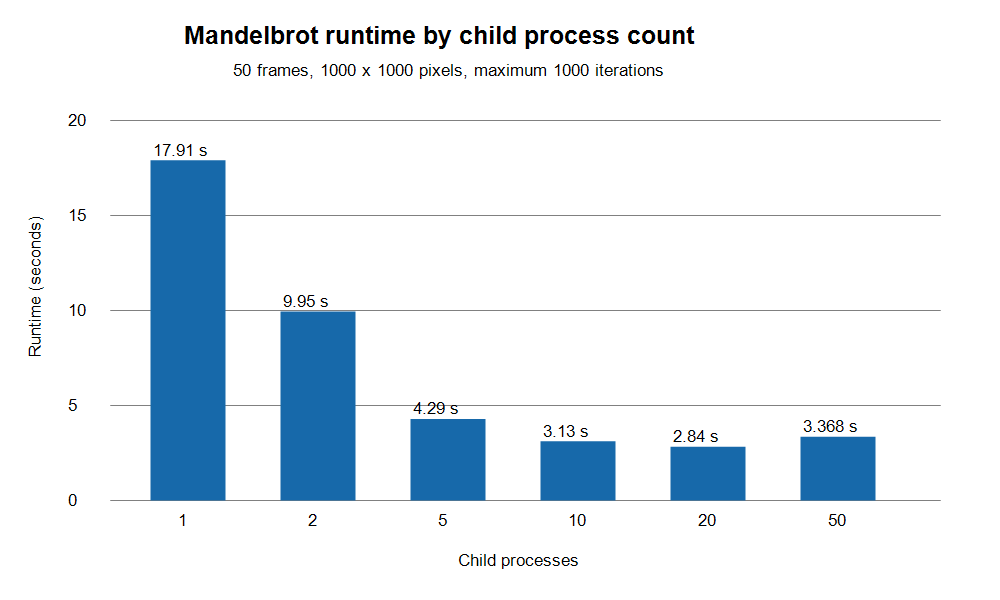

# CPE-2600 Lab 11: Multiprocessing


## Implementation

`mandel` renders one Mandelbrot image. `mandelmovie` uses `fork` and `exec` to run independent `mandel` children, forking to the requested number of forks. By default it renders 50 frames centered at `(-0.38, -0.665)`, reducing the scale by 10% for each frame. It waits for all children and reports a failure if a frame could not be generated.

Build both programs with:

```bash
make
```

Generate the default 50 frames with, for example, four child processes:

```bash
./mandelmovie -p 4
```

The frames are named `mandel0.jpg` through `mandel49.jpg`. Use `./mandelmovie -h` for all options. For example, `-n` changes the number of frames, `-x` and `-y` set the zoom center, `-s` sets the first frame's scale, and `-z` sets the scale multiplier per frame.

Create the movie from the frame sequence with:

```bash
ffmpeg -i 'mandel%d.jpg' mandel.mpg
```

## Runtime report

The graph show elapsed (real) time for each process count.



**Discussion:** Run time decreased from 17.91 seconds with one child to 2.84 seconds with 20 children (about 6.3 times faster). With 50 children, run time increased to 3.368 seconds, so more processes did not always improve performance. Process scheduling, resource usage, and other OS activity can affect the results.
